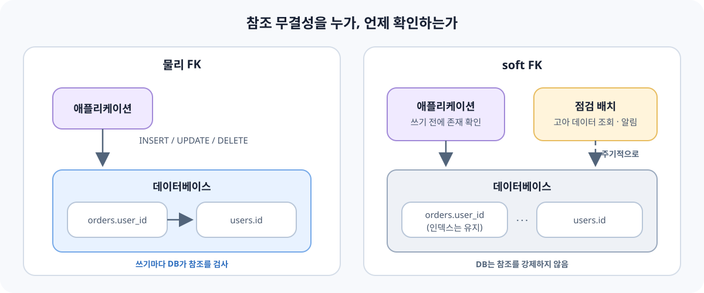

얼마 전 실무에서 테이블에 걸려 있던 물리 FK(외래 키 제약)를 soft FK로 바꿔달라는 요청을 받았다. 처음에는  조금 의아하면서도, 한편으로는 내가 뭔가 잘못 알고 있었구나 싶었다. 데이터베이스를 처음 배울 때 외래 키는 참조 무결성을 지키는 기본 장치로 배웠고, 이를 걷어낸다는 것이 한번에 와닿지 않았기 때문이다.

나는 데이터베이스를 전문으로 다루고 있는지는 않아서, 관련 지식 대부분이 교과서나 강의에서 접한 이론에 가깝다. 그러다 보니 실무에서 자연스럽게 받아들여지는 관행과 내가 알고 있던 원칙 사이에 간극이 있다는 걸 이번에 새삼 느꼈다. 찾아보니 FK 말고도 비슷한 사례가 꽤 있었다.

이 글은 그 간극을 정리해본 기록이다. 다만 여기서 다루는 내용은 **어느 쪽이 옳다는 이야기가 아니다.** 대부분은 조직의 규모, 사용하는 데이터베이스, 팀의 운영 방식, 서비스의 성격에 따라 달라지는 습관이나 트레이드오프에 가깝다. 같은 질문에도 팀마다 다른 답을 하고 있을 것이고, 이론에서 배운 방식을 그대로 잘 쓰고 있는 곳도 많을 것이다. 그런 전제로 "이런 선택을 하는 경우도 있고, 그 배경에는 이런 이유가 있다고 한다" 정도로 읽어주시면 좋겠다.

## 물리 FK와 soft FK

먼저 용어부터 짚어두면, 여기서 말하는 **물리 FK**는 데이터베이스에 `FOREIGN KEY` 제약을 실제로 선언한 것을 말한다. 반면 **soft FK**(논리 FK라고도 부르는 것 같다)는 `orders.user_id`처럼 다른 테이블을 가리키는 컬럼은 그대로 두되, 데이터베이스 차원의 제약은 걸지 않는 방식이다. 참조 관계는 문서나 네이밍, 애플리케이션 코드로만 표현된다.

```sql
-- 물리 FK
CREATE TABLE orders (
    id      BIGINT PRIMARY KEY,
    user_id BIGINT NOT NULL,
    FOREIGN KEY (user_id) REFERENCES users (id)
);

-- soft FK: 컬럼과 인덱스는 두고, 제약은 선언하지 않음
CREATE TABLE orders (
    id      BIGINT PRIMARY KEY,
    user_id BIGINT NOT NULL,
    INDEX idx_orders_user_id (user_id)
);
```

### 이론에서 FK가 해주는 일

교과서적인 설명을 빌리면, FK는 **참조 무결성**을 데이터베이스가 직접 보장하게 해준다. 존재하지 않는 사용자를 가리키는 주문은 애초에 저장되지 않고, 주문이 남아 있는 사용자는 함부로 삭제되지 않는다. 애플리케이션에 버그가 있어도, 누군가 콘솔에서 직접 쿼리를 날려도, 데이터베이스가 마지막 방어선이 되어준다. 스키마만 보고도 테이블 간 관계를 알 수 있고, ERD 도구가 관계를 자동으로 그려주는 것도 FK 덕분이다.

이렇게 놓고 보면 FK를 빼는 이유가 잘 떠오르지 않는다. 그런데 실무 관련 글이나 발표를 찾아보면, 특히 규모가 있는 서비스에서 FK 제약을 두지 않는 경우가 드물지 않다고 한다.

### soft FK를 선택하는 배경으로 자주 언급되는 것들

찾아본 범위에서 자주 언급되는 배경은 대략 이런 것들이었다. 모든 조직에 해당하는 이야기는 아니고, 이 중 한두 가지만 해당해도 선택이 달라질 수 있는 것 같다.

**쓰기 시점의 검사 비용과 잠금.** FK가 있으면 자식 테이블에 쓸 때마다 부모 테이블에 해당 행이 있는지 확인해야 한다. MySQL 문서에 따르면 FK로 연결된 테이블에는 필요에 따라 메타데이터 잠금이 확장되고, 부모 행을 확인하는 과정에서도 잠금이 발생할 수 있다고 한다. 트래픽이 적을 때는 거의 드러나지 않지만, 같은 부모 행을 참조하는 쓰기가 몰리는 상황에서는 잠금 경합이나 데드락의 원인으로 지목되는 경우가 있다고 한다.

**스키마 변경과 운영 도구.** 운영 중인 대형 테이블의 스키마를 바꿀 때 온라인 마이그레이션 도구를 쓰는 경우가 많은데, 이 도구들이 FK와 잘 맞지 않는 경우가 있다. 예를 들어 GitHub의 gh-ost는 문서에서 "Foreign key constraints are not supported"라고 명시하고 있다. 이런 도구에 의존하는 팀이라면 FK를 두지 않는 쪽이 운영상 자연스러운 선택이 될 수 있다.

**파티셔닝, 샤딩, 서비스 분리.** 데이터를 여러 데이터베이스나 샤드로 나누면, 서로 다른 곳에 있는 테이블 사이에는 애초에 FK를 걸 수 없다. MySQL InnoDB는 사용자 정의 파티셔닝을 쓰는 테이블에서 FK를 지원하지 않는다고 문서에 적혀 있다. 서비스별로 데이터베이스를 나누는 구조에서도 마찬가지로, 다른 서비스의 테이블은 ID로만 참조하게 된다.

**데이터 적재와 삭제 순서.** FK가 있으면 데이터를 넣고 지우는 순서를 부모 → 자식(삽입), 자식 → 부모(삭제)로 지켜야 한다. 대량 적재나 데이터 이관, 테스트 데이터 정리처럼 순서를 맞추기 번거로운 작업이 잦은 환경에서는 이것이 부담으로 느껴질 수 있다고 한다.

**무결성 검사를 애플리케이션에서 이미 하고 있는 경우.** ORM이나 도메인 로직에서 이미 참조 대상의 존재를 확인하고 있다면, 데이터베이스가 같은 검사를 한 번 더 하는 셈이 된다. 이를 중복으로 보는 시각도 있고, 반대로 "그래도 마지막 방어선은 있어야 한다"고 보는 시각도 있는 것 같다.



### soft FK로 바꾸면 내려놓게 되는 것

반대로 soft FK를 택하면 데이터베이스가 해주던 일을 다른 곳에서 챙겨야 한다. 이 부분은 이론에서 배운 내용이 그대로 유효한 것 같다.

- **고아 데이터가 생길 수 있다.** 부모가 지워졌는데 자식이 남아 있거나, 존재하지 않는 ID를 가리키는 행이 저장될 수 있다. 버그, 수동 쿼리, 동시성 문제 등 경로는 다양하다.
- **관계가 스키마에서 사라진다.** 새로 합류한 사람이 스키마만 보고는 어떤 컬럼이 어디를 가리키는지 알기 어렵고, ERD 도구도 관계를 자동으로 그려주지 못한다.
- **검증 책임이 코드 여러 곳으로 퍼진다.** 같은 테이블에 쓰는 경로가 여러 개라면, 각 경로에서 빠짐없이 검증해야 한다.

그래서 soft FK를 쓰는 팀들은 이런 보완책을 함께 두는 경우가 많다고 한다.

| 내려놓은 것 | 흔히 함께 두는 보완책 |
|---|---|
| 쓰기 시점의 참조 검사 | 애플리케이션 계층의 존재 확인, 쓰기 경로를 한 곳으로 모으기 |
| 고아 데이터 방지 | 주기적인 고아 데이터 점검 쿼리와 알림 |
| 스키마상의 관계 표현 | `user_id`처럼 일관된 네이밍, 컬럼 코멘트, 별도 ERD 문서 |
| FK가 만들어주던 인덱스 | 참조 컬럼 인덱스를 명시적으로 생성 |

마지막 줄은 놓치기 쉬운 부분 같다. MySQL은 FK를 선언하면 참조하는 쪽 컬럼에 인덱스가 없을 때 자동으로 만들어준다. 그래서 FK만 걷어내면, 그동안 FK 덕분에 있던 인덱스의 존재를 의식하지 못한 채 넘어갈 수 있다. 참고로 PostgreSQL은 FK를 선언해도 참조하는 쪽에 인덱스를 자동으로 만들지 않으며, 부모 행 삭제·갱신 시 자식 테이블을 스캔해야 하므로 인덱스를 따로 두는 것이 좋은 경우가 많다고 문서에서 안내한다. 데이터베이스마다 기본 동작이 다르다는 점도 함께 기억해두면 좋을 것 같다.

고아 데이터 점검은 생각보다 단순한 쿼리로 시작할 수 있다.

```sql
-- 존재하지 않는 사용자를 가리키는 주문
SELECT o.id, o.user_id
FROM orders o
LEFT JOIN users u ON u.id = o.user_id
WHERE u.id IS NULL;
```

### 어느 쪽이 맞다기보다

정리하다 보니, 물리 FK와 soft FK는 "참조 무결성을 지킬 것인가 말 것인가"의 선택이라기보다 **"그 책임을 데이터베이스에 둘 것인가, 애플리케이션과 운영 프로세스에 둘 것인가"**의 선택에 가까워 보였다. 트래픽이 크지 않고 하나의 데이터베이스를 쓰는 서비스라면 물리 FK가 주는 안전함이 더 클 수 있고, 대규모 트래픽이나 분산 구조, 특정 운영 도구에 맞춰진 환경이라면 soft FK가 더 자연스러울 수 있다. 처음에는 물리 FK로 시작했다가 규모가 커지면서 바꾸는 경우도 있다고 한다.

이번 요청도 아마 우리 환경의 이런 사정 중 어딘가에서 나왔을 것이라고 생각한다. 이유를 정확히 알지 못한 채 변경만 하기보다는, 어떤 배경에서 나온 요청인지 한 번 여쭤보고 보완책을 함께 챙기는 것이 좋겠다는 생각이 들었다.

## 그 밖에 자주 보이는 간극들

FK를 찾아보다가 비슷한 결의 이야기를 몇 가지 더 만났다. 아래 내용도 마찬가지로 조직과 상황에 따라 다르고, 어떤 팀은 정반대로 운영하고 있을 수 있다.

### ON DELETE CASCADE

이론에서는 부모를 지우면 자식도 함께 지워지게 하는 `ON DELETE CASCADE`를 편리한 기능으로 배운다. 실무에서는 이를 조심스럽게 쓰거나 피하는 경우가 있다고 한다. 하나의 삭제가 연결된 여러 테이블로 연쇄적으로 퍼지면서 예상보다 많은 데이터가 지워지거나, 그 과정에서 잠금이 오래 잡히는 상황을 우려하기 때문이다. FK로 연결된 테이블에는 잠금이 함께 확장될 수 있어서, 연쇄 범위가 넓을수록 영향도 커질 수 있다. 그래서 삭제는 애플리케이션에서 순서를 정해 명시적으로 처리하는 방식을 택하기도 하는 것 같다.

### 정규화와 의도적인 중복

정규화는 중복을 없애 갱신 이상을 막는 원칙으로 배운다. 실무에서는 조회 성능이나 쿼리 단순화를 위해 일부러 중복을 두는 경우도 꽤 보인다고 한다. 게시글 테이블에 댓글 수를 컬럼으로 저장해두거나, 주문 테이블에 주문 당시의 상품명과 가격을 복사해두는 식이다.

다만 후자는 단순한 비정규화라기보다 **그 시점의 사실을 기록**하는 의미가 있다는 설명도 있었다. 상품 가격이 나중에 바뀌어도 주문 당시 가격은 그대로 남아 있어야 하기 때문이다. 같은 "중복"처럼 보여도 목적이 다를 수 있다는 점이 흥미로웠다.

### 물리 삭제 대신 soft delete

`DELETE`로 행을 지우는 대신 `deleted_at` 같은 컬럼에 삭제 시각을 기록하는 soft delete도 흔히 보이는 관행이라고 한다. 복구 요청에 대응하기 쉽고, 이력 추적이나 감사 목적에도 도움이 되기 때문이다.

대신 신경 써야 할 부분도 생긴다. 모든 조회에 `deleted_at IS NULL` 조건을 빠뜨리지 않아야 하고, 유니크 제약도 고민거리가 된다. 예를 들어 이메일에 유니크 제약이 걸려 있으면, 탈퇴한 사용자의 행이 남아 있어 같은 이메일로 재가입이 막힐 수 있다. PostgreSQL에서는 부분 인덱스(`WHERE deleted_at IS NULL`)로 이를 다루기도 한다. 개인정보 보관 기간 같은 규정과도 맞물리는 부분이라, 조직마다 정책이 많이 다를 것 같다.

### 자연 키와 대리 키

이론에서는 주민번호나 이메일처럼 의미 있는 값을 키로 쓰는 자연 키(natural key)와, 의미 없는 일련번호를 쓰는 대리 키(surrogate key)를 함께 배운다. 실무에서는 대부분의 테이블에 자동 증가 정수나 UUID 같은 대리 키를 기본 키로 두는 경우가 많다고 한다. 자연 키로 여겼던 값도 바뀌거나 중복될 수 있고, 여러 컬럼을 묶은 복합 키는 참조하는 쪽까지 복잡하게 만들기 때문이다.

자연 키가 사라지는 것은 아니고, 대리 키를 기본 키로 두면서 자연 키에는 유니크 제약을 거는 방식이 자주 언급된다. UUID를 쓸 때는 인덱스 삽입 성능을 고려해 시간순으로 정렬되는 형식(UUIDv7 등)을 택하기도 한다고 한다.

### ENUM 타입

상태값처럼 정해진 값만 들어가는 컬럼에 데이터베이스의 ENUM 타입을 쓰면, 잘못된 값이 들어가는 것을 막을 수 있다. 실무에서는 ENUM 대신 문자열이나 정수 컬럼을 두고 허용 값은 애플리케이션 상수로 관리하거나, 별도의 코드 테이블을 두는 경우도 있다고 한다. 새로운 상태값을 추가할 때마다 스키마 변경이 필요한 점, 데이터베이스마다 ENUM의 동작이 다른 점 등이 이유로 언급된다. 반대로 값이 거의 바뀌지 않는다면 ENUM이나 CHECK 제약이 주는 안전함을 선호하는 팀도 있을 것이다.

### 트리거와 저장 프로시저

비즈니스 규칙을 데이터베이스 가까이에 두는 트리거와 저장 프로시저도 이론에서는 유용한 도구로 배운다. 실무에서는 로직을 가능한 한 애플리케이션 코드에 두는 쪽을 선호하는 경우가 많다고 한다. 버전 관리, 코드 리뷰, 테스트, 디버깅이 익숙한 도구 안에서 이뤄지고, 데이터를 바꾸는 경로가 눈에 보이는 곳에 있기를 원하기 때문이다. 물론 데이터베이스 중심으로 업무가 설계된 조직이나 레거시 시스템에서는 여전히 중요한 역할을 하고 있을 것이다.

## 한눈에 보면

| 주제 | 이론에서 배우는 모습 | 실무에서 보이기도 하는 선택 | 함께 언급되는 배경 |
|---|---|---|---|
| 외래 키 | 물리 FK로 참조 무결성 보장 | soft FK + 애플리케이션 검증 | 쓰기 잠금, 온라인 마이그레이션, 샤딩·서비스 분리 |
| 연쇄 삭제 | `ON DELETE CASCADE` | 애플리케이션에서 명시적 삭제 | 예상치 못한 대량 삭제, 잠금 |
| 정규화 | 중복 제거 | 집계 컬럼, 시점 스냅샷 | 조회 성능, 이력 보존 |
| 삭제 | `DELETE` | `deleted_at` soft delete | 복구, 감사, 이력 |
| 키 | 자연 키 활용 | 대리 키 + 자연 키 유니크 제약 | 값의 변경 가능성, 참조 단순화 |
| 정해진 값 | ENUM, CHECK | 문자열·코드 테이블 + 앱 상수 | 스키마 변경 빈도, 이식성 |
| 로직 위치 | 트리거, 저장 프로시저 | 애플리케이션 코드 | 버전 관리, 테스트, 가시성 |

## 정리하며

이번에 찾아보면서 느낀 것은, 실무의 관행이 이론을 무시해서 생긴 것이라기보다 **이론이 전제하지 않았던 조건들**, 예를 들어 큰 트래픽, 무중단 배포, 여러 서비스와 여러 데이터베이스, 팀 단위의 협업 같은 조건에 맞춰 조정된 결과에 가까워 보인다는 점이다. 그리고 그 조정에는 내려놓게 되는 트레이드오프가 있다. 물리 FK를 걷어내면 참조 무결성의 책임이 다른 곳으로 옮겨가고, soft delete를 쓰면 조회와 제약 설계가 조금 더 복잡해진다.

그래서 나처럼 이론으로 먼저 접한 입장에서는, 실무의 컨벤션을 "원래 이렇게 하는 것"으로 받아들이기보다 **"이 환경에서는 왜 이렇게 하는가"**를 한 번씩 여쭤보는 것이 도움이 될 것 같다. 반대로 이론에서 배운 원칙이 지키려던 것이 무엇인지 기억해두면, 그 원칙을 내려놓는 상황에서도 무엇을 대신 챙겨야 할지 떠올리기 쉬울 것이다.

이 글에 적은 내용은 찾아본 자료와 일반적으로 언급되는 이야기를 정리한 것이라, 실제 현장에서는 다르게 운영되는 경우도 많을 것이다. 더 정확한 맥락이나 다른 사례를 알게 되면 계속 보완해나가려고 한다.

## 참고 자료

- [MySQL 8.4 Reference Manual — FOREIGN KEY Constraints](https://dev.mysql.com/doc/refman/8.4/en/create-table-foreign-keys.html)
- [PostgreSQL Documentation — Constraints (Foreign Keys)](https://www.postgresql.org/docs/current/ddl-constraints.html)
- [gh-ost — Requirements and limitations](https://github.com/github/gh-ost/blob/master/doc/requirements-and-limitations.md)
