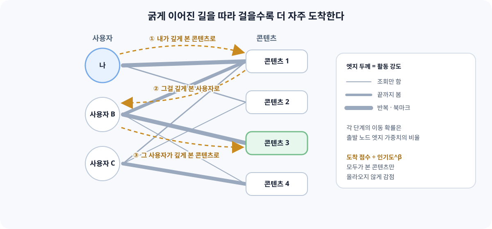

[지난번 그래프 기반 추천 글](/blog/graph-based-recommender-systems/)에서는 협업 필터링에서 출발해 그래프 임베딩, LightGCN 같은 GNN, 지식 그래프 GNN까지 훑었다. 그 글의 구축 순서에서 "규칙과 그래프 탐색으로 시작하고, 로그가 쌓이면 임베딩과 GNN을 붙인다"고 적었는데, 정작 그 사이에 있는 방법들은 거의 다루지 않았다. 학습 없이 **그래프 구조만으로 점수를 매기는** random walk 계열이다.

이 주제를 다시 꺼낸 건 실무에서 비슷한 설계를 고민하고 있어서다. 사용자가 콘텐츠에 얼마나 활발하게 활동했는지를 엣지 가중치로 두고, 그 그래프를 걸어 다니며 콘텐츠를 추천하면 어떨까 하는 구상이다. 아이디어는 단순하지만 막상 설계하려니 "활동 강도를 어떻게 숫자로 만들지", "활발한 사용자 몇 명이 그래프를 지배하지 않을지" 같은 질문이 줄줄이 나왔다. 이번 글에서는 PageRank부터 RP3β까지 전통적인 그래프 추천 방법을 정리하고, 활동 강도를 엣지로 쓸 때 짚어야 할 지점을 설계 관점에서 정리해보려 한다.

## 왜 다시 전통적인 방법인가

GNN 이야기를 하다가 PageRank로 돌아가는 게 뒷걸음질처럼 보일 수 있다. 그런데 이쪽 방법들이 여전히 의미 있는 이유가 몇 가지 있다.

첫째, **강한 기준선**이다. RecSys 2019의 [Are We Really Making Much Progress?](https://arxiv.org/abs/1907.06902)는 최근 신경망 추천 모델 18개를 재현하려 했는데, 재현에 성공한 7개 중 6개가 최근접 이웃이나 그래프 기반의 단순한 휴리스틱에 자주 밀렸다고 보고했다. 여기서 비교에 쓰인 그래프 기반 방법이 이 글에서 다룰 P3α, RP3β다. 지난 글에서 "복잡한 모델은 강한 기준 모델과 비교해야 한다"고 적었는데, 그 기준 모델이 바로 이쪽이다.

둘째, **학습이 없다.** 그래프만 있으면 바로 점수가 나온다. 로그가 충분히 쌓이지 않은 초기 서비스나, 새 활동이 계속 들어와서 모델을 자주 다시 학습하기 어려운 환경에서 다루기 쉽다.

셋째, **설명이 된다.** 점수가 "나 → 콘텐츠 1 → 사용자 B → 콘텐츠 3"처럼 그래프 위의 경로에서 나오기 때문에, 왜 이 콘텐츠가 올라왔는지를 경로로 되짚을 수 있다.

넷째, 웹 규모에서도 실제로 쓰였다. Twitter의 Who to Follow는 사용자 주변을 random walk로 탐색해 후보를 만들었고, Pinterest의 [Pixie](https://arxiv.org/abs/1711.07601)는 30억 노드·170억 엣지 그래프에서 random walk로 실시간 추천을 제공했다. 지난 글에서 다룬 PinSage도 이웃을 고를 때 random walk를 쓴다는 점을 떠올리면, 이 계열은 GNN 이전의 방법이라기보다 GNN 안에도 녹아 있는 기본기에 가깝다.

## PageRank: 중요한 노드는 중요한 노드가 가리킨다

PageRank는 웹 페이지의 중요도를 링크 구조로 계산하려고 만든 알고리즘이다. 직관은 "많은 페이지가, 특히 중요한 페이지가 가리키는 페이지가 중요하다"는 것이다. 이를 random surfer로 설명한다. 사용자가 링크를 무작위로 따라가다가 일정 확률로 아무 페이지로 순간이동한다고 할 때, 오래 걸었을 때 각 페이지에 머무르는 비율이 PageRank 점수다.

```text
PR(v) = (1 - d) / N + d × Σ_{u → v} PR(u) / out(u)
```

- `d`는 링크를 계속 따라갈 확률(damping factor)로, 보통 0.85를 쓴다.
- `1 - d`는 아무 노드로 순간이동할 확률이다. 막다른 노드에 갇히지 않게 해준다.
- `out(u)`는 u에서 나가는 링크 수다. 가중치 그래프라면 링크 수 대신 엣지 가중치의 비율로 이동 확률을 나눈다.

추천에 그대로 쓰면 한계가 바로 보인다. PageRank는 **모든 사람에게 같은 점수**를 준다. 사용자-콘텐츠 그래프에 그대로 돌리면 많이 연결된 콘텐츠가 위로 올라오는, 사실상 인기순 추천이 된다. 전체 인기 목록이나 콜드스타트 사용자용 기본값으로는 쓸 만하지만 개인화는 아니다.

## Personalized PageRank: 나에게서 출발해 나에게로 돌아오기

개인화의 열쇠는 순간이동 대상에 있다. PageRank가 아무 노드로나 순간이동한다면, **Personalized PageRank(PPR)**는 항상 특정 노드 집합, 예를 들어 내가 최근 본 콘텐츠들로만 돌아간다. 그래서 random walk with restart라고도 부른다.

```text
PPR_s(v) = (1 - d) × s(v) + d × Σ_{u → v} PPR_s(u) × P(u → v)
```

`s`는 출발점 분포다. 내가 활동한 콘텐츠에 확률을 나눠 주고, 나머지는 0이다. 걷다가 일정 확률로 계속 출발점으로 돌아오니, 출발점 근처의 노드일수록 자주 방문된다. 점수가 "그래프 위에서 나와 얼마나 가까운가"를 뜻하게 되는 것이다.

`d`를 어떻게 잡느냐가 추천 성격을 바꾼다. `d`가 작으면 자주 돌아오니 내 바로 주변만 보고, 크면 멀리까지 걸어가니 탐색 범위가 넓어지는 대신 전체 인기 쪽으로 끌려간다. 지난 글에서 "다중 홉은 멀리 갈수록 의미가 약해지고 잡음이 커진다"고 적었던 문제를, PPR에서는 이 숫자 하나로 조절하는 셈이다.

Twitter의 Who to Follow가 이 구조를 썼다. 사용자에게서 출발하는 PPR로 가까운 계정들("circle of trust")을 먼저 뽑고, 그 위에서 추가 알고리즘으로 팔로우 후보를 정했다. 전체 그래프를 학습하는 대신 **사용자 주변만 걸어보는** 방식이고, 그래프 전체를 한 서버의 메모리에 올려 처리했다.

## 사용자-콘텐츠 그래프 위의 세 걸음: P3와 RP3β

추천에서 가장 흔한 그래프는 사용자와 콘텐츠로 된 이분 그래프다. 이 그래프에서 random walk는 사용자와 콘텐츠를 번갈아 밟는다. 그러면 **세 걸음**이 자연스러운 단위가 된다.

```text
나 → (내가 본) 콘텐츠 → (그 콘텐츠를 본) 다른 사용자 → (그 사용자가 본) 새 콘텐츠
```

이 세 걸음을 걸었을 때 각 콘텐츠에 도착할 확률을 그대로 점수로 쓰는 것이 **P3**다. 첫 걸음과 둘째 걸음을 합치면 "나와 비슷한 사용자"를, 둘째와 셋째를 합치면 "함께 소비된 콘텐츠"를 찾는 셈이라, 사용자 기반·아이템 기반 협업 필터링을 확률의 언어로 다시 쓴 것으로 볼 수도 있다. 반복해서 돌릴 필요 없이 희소 행렬 곱 세 번이면 계산된다.

문제는 P3도 인기 편향이 강하다는 것이다. 많은 사람이 본 콘텐츠는 둘째 걸음에서 어떤 사용자로 가든 셋째 걸음에서 도착하기 쉽다. 이를 보정한 것이 **RP3β**다.

- 이동 확률에 지수 α를 걸어(`P^α`) 강한 연결과 약한 연결의 차이를 조절한다. α가 1보다 크면 강한 연결이 더 도드라진다.
- 도착한 콘텐츠의 점수를 그 콘텐츠의 인기도의 β제곱으로 나눈다. β가 0이면 P3와 같고, 클수록 덜 알려진 콘텐츠가 올라온다.

파라미터가 둘뿐이고 의미가 분명해서, 검증 데이터에서 Recall과 커버리지를 보며 조절하기 쉽다.



여기까지 보면 하나 눈에 띄는 것이 있다. 위 수식 어디에도 "엣지가 1이어야 한다"는 조건은 없다. 이동 확률은 출발 노드의 엣지 가중치 비율로 정해지니, **엣지에 무엇을 넣느냐가 곧 어떤 걸음을 걷느냐**다. 클릭 여부 대신 활동 강도를 넣으면, 내가 깊게 본 콘텐츠로 더 자주 가고, 그 콘텐츠를 깊게 본 사용자로 더 자주 가고, 그 사용자가 깊게 본 콘텐츠에 더 자주 도착한다. 고민하던 설계가 정확히 이 지점이다.

## 활동 강도를 엣지로 만들 때의 설계 고민

엣지 가중치를 바꾸는 건 코드 한 줄이지만, 그 숫자를 무엇으로 만들지는 꽤 많은 결정을 요구한다.

### 1. 어떤 활동을 얼마나 셀 것인가

"활동"이라는 말 안에는 서로 다른 신호가 섞여 있다. 조회, 일정 시간 이상 체류, 끝까지 봄, 다시 봄, 북마크, 공유 같은 것들이다. 이 신호들은 같은 단위가 아니고, 같은 의미도 아니다.

| 신호 | 의미 | 주의할 점 |
|---|---|---|
| 조회 | 관심이 있었다 | 썸네일·제목에 끌린 것일 수 있다 |
| 체류 시간 | 실제로 봤다 | 콘텐츠 길이에 비례하므로 길이로 나눠야 비교된다 |
| 완료 | 끝까지 봤다 | 짧은 콘텐츠일수록 쉽게 완료된다 |
| 재방문·반복 | 다시 찾을 만했다 | 이해가 안 돼서 반복한 것일 수도 있다 |
| 북마크·공유 | 명시적으로 가치를 표시했다 | 빈도가 낮아 희소하다 |

처음에는 신호별 가중치를 정해 합치는 단순한 방식이 다루기 쉽다. 다만 이 가중치는 정책이라는 점을 의식해야 한다. 완료를 조회의 세 배로 볼지 다섯 배로 볼지는 데이터가 정해주지 않는다. 추천 결과를 보며 조정할 수 있도록 설정으로 빼두는 편이 좋다.

부정 신호도 생각해야 한다. 열자마자 나가거나 건너뛴 것은 관심이 없다는 신호에 가깝다. 그런데 random walk의 이동 확률은 음수가 될 수 없다. 음수 엣지를 만드는 대신 **그 활동을 가중치에서 빼거나, 아예 엣지를 만들지 않거나, 재랭킹 단계에서 필터로 쓰는** 쪽으로 처리해야 한다.

### 2. 많이 할수록 계속 커지게 둘 것인가

같은 콘텐츠를 열 번 본 사용자와 한 번 본 사용자의 차이가 열 배여야 할까. 대부분은 아닐 것이다. 반복 활동을 그대로 더하면, 한 콘텐츠를 수십 번 반복한 몇몇 기록이 그 주변의 걸음을 독차지한다. 그래서 `log(1 + x)`처럼 커질수록 증가폭이 줄어드는 변환을 거치거나 상한을 두는 편이 안전하다.

### 3. 활발한 사용자가 그래프를 지배하지 않게

활동 강도를 엣지로 쓰면 **활동량이 많은 사용자**의 영향력이 커진다. 첫 걸음(나 → 콘텐츠)은 내 엣지들끼리 비율을 내니 문제가 없다. 신경 쓰이는 건 둘째 걸음(콘텐츠 → 사용자)이다. 한 콘텐츠에 연결된 사용자 중 그 콘텐츠를 강하게 소비한 사용자 쪽으로 더 자주 가는데, 활동량이 많은 사용자는 거의 모든 콘텐츠에서 강한 엣지를 가지고 있을 가능성이 높다. 그러면 걸음이 계속 몇몇 헤비 유저를 거쳐 가고, 추천이 그들의 취향으로 수렴한다.

그래서 엣지 가중치를 만들 때 **사용자별로 정규화**하는 단계를 하나 두는 게 좋다. 예를 들어 사용자 안에서 활동 강도의 순위나 비율로 바꾸면 "이 사용자에게 이 콘텐츠가 상대적으로 얼마나 중요했는가"를 뜻하게 된다. 같은 이유로 평가할 때도 사용자를 활동량 구간별로 나눠, 가벼운 사용자에게 추천 품질이 떨어지지 않는지 따로 봐야 한다.

### 4. 오래된 활동은 얼마나 빨리 잊을 것인가

활동 강도에는 시간 차원이 있다. 반년 전에 깊게 본 콘텐츠와 어제 깊게 본 콘텐츠가 같은 무게여야 하는지는 서비스마다 다르다. 관심사가 빨리 바뀌는 콘텐츠라면 반감기를 짧게, 누적 학습처럼 이전 활동이 계속 의미 있는 도메인이라면 길게 잡는다. 반감기를 하나의 파라미터로 두고 지수 감쇠를 거는 방식이 가장 단순하다.

```text
w(u, i) = log(1 + Σ_e  signal_weight(e) × 0.5^(age(e) / half_life))
```

### 5. 노출되지 않은 콘텐츠는 활동할 기회도 없었다

지난 글에서 "클릭하지 않았다는 사실이 곧 싫어한다는 뜻은 아니다"라고 적었다. 활동 강도 그래프에서는 이 문제가 더 직접적으로 드러난다. 사용자는 **보여준 콘텐츠에만** 활동할 수 있다. 추천 결과가 다시 활동을 만들고, 그 활동이 다시 엣지가 되어 같은 콘텐츠를 더 자주 추천하는 되먹임 고리가 생긴다. 상단에 노출된 콘텐츠의 엣지는 계속 굵어지고, 한 번도 노출되지 않은 콘텐츠는 그래프에 끼어들 틈이 없다.

완전히 막을 수는 없지만, 몇 가지는 설계 단계에서 챙길 수 있다.

- 노출 로그를 활동 로그와 함께 남긴다. 나중에 "노출 대비 활동"으로 가중치를 보정하거나, 편향을 측정할 수 있다.
- RP3β의 β로 인기 콘텐츠를 감점한다.
- 재랭킹 단계에서 신규·저노출 콘텐츠에 일정 비율의 자리를 준다.

### 6. 그래프를 무엇으로 이을 것인가

여기까지는 사용자-콘텐츠 이분 그래프를 가정했지만, 활동 강도를 쓰는 그래프의 모양은 몇 가지가 가능하다.

| 그래프 | 엣지의 의미 | 장점 | 주의할 점 |
|---|---|---|---|
| 사용자-콘텐츠 | 그 사용자가 그 콘텐츠에 얼마나 활동했나 | 개인화가 자연스럽다 | 사용자 수만큼 그래프가 커진다 |
| 콘텐츠-콘텐츠 | 두 콘텐츠를 함께 강하게 소비한 정도 | 그래프가 작고 미리 계산해두기 쉽다 | 사용자 개인의 맥락이 희석된다 |
| 이종 그래프 | 활동 엣지 + 콘텐츠-개념·카테고리 엣지 | 신규 콘텐츠도 개념 엣지로 도달 가능 | 엣지 종류 간 가중치 균형을 정해야 한다 |

이종 그래프는 지난 글의 지식 그래프와 이어지는 지점이다. 활동 엣지만 있으면 신규 콘텐츠는 아무도 활동하지 않았으니 도착할 길이 없다. 콘텐츠와 개념·카테고리를 잇는 엣지를 함께 두면, PPR이 "내가 깊게 본 콘텐츠 → 그 콘텐츠의 개념 → 같은 개념의 신규 콘텐츠"로도 걸어갈 수 있다. 대신 활동 엣지와 개념 엣지의 가중치를 어떤 비율로 둘지가 새로운 설계 변수가 된다.

## 코드로 보면

사용자-콘텐츠 그래프에서 활동 강도 엣지를 만들고 RP3β로 점수를 내는 과정을 희소 행렬로 쓰면 이 정도다. 실제 시스템의 코드가 아니라 구조를 보기 위한 예시다.

```python
import numpy as np
import pandas as pd
import scipy.sparse as sp

SIGNAL_WEIGHT = {"view": 1.0, "complete": 3.0, "bookmark": 4.0}
HALF_LIFE_DAYS = 14

def build_weights(events: pd.DataFrame, now: pd.Timestamp, n_users: int, n_items: int):
    # events: user_idx, item_idx, signal, ts
    age_days = (now - events["ts"]).dt.total_seconds() / 86400
    decay = 0.5 ** (age_days / HALF_LIFE_DAYS)
    raw = events["signal"].map(SIGNAL_WEIGHT) * decay

    agg = (events.assign(w=raw)
                 .groupby(["user_idx", "item_idx"])["w"].sum()
                 .reset_index())
    agg["w"] = np.log1p(agg["w"])          # 반복 활동은 체감되도록 포화

    return sp.csr_matrix((agg["w"], (agg["user_idx"], agg["item_idx"])),
                         shape=(n_users, n_items))

def row_normalize(m):
    s = np.asarray(m.sum(axis=1)).ravel()
    s[s == 0] = 1.0
    return sp.diags(1.0 / s) @ m

def rp3beta(W, alpha=1.0, beta=0.5):
    P_ui = row_normalize(W).power(alpha)    # 사용자 → 콘텐츠
    P_iu = row_normalize(W.T).power(alpha)  # 콘텐츠 → 사용자
    S = (P_iu @ P_ui).tocsr()               # 콘텐츠 → 사용자 → 콘텐츠

    popularity = np.asarray((W > 0).sum(axis=0)).ravel().astype(float)
    popularity[popularity == 0] = 1.0
    S = S @ sp.diags(1.0 / popularity ** beta)   # 도착 콘텐츠의 인기도로 나눔
    return P_ui, S

def recommend(u, P_ui, S, W, k=10):
    scores = (P_ui[u] @ S).toarray().ravel()
    scores[W[u].indices] = -np.inf          # 이미 본 콘텐츠 제외
    return np.argsort(-scores)[:k]
```

몇 가지를 덧붙이면 이렇다.

- `S`는 콘텐츠 × 콘텐츠 행렬이다. 콘텐츠 수가 많으면 콘텐츠마다 상위 k개 이웃만 남기는 식으로 잘라야 메모리에 올라간다. 공개 구현체들도 대부분 이웃 수(topK)를 파라미터로 둔다.
- 위 코드에는 사용자별 정규화를 따로 넣지 않았다. `row_normalize(W.T)`가 둘째 걸음의 이동 확률을 만드는데, 이때 쓰이는 값이 사용자별 정규화 전의 활동 강도라 헤비 유저 쪽으로 기운다. 앞에서 말한 사용자 내 순위·비율 변환을 `build_weights` 끝에 넣는 것이 다음 실험이다.
- `S`를 미리 계산해두면 추천 시점에는 사용자 벡터와 행렬 곱 한 번이면 된다. 활동이 계속 들어오는 환경이라면 `S`를 얼마나 자주 다시 만들지도 정해야 한다.

## 오프라인으로 계산할까, 요청 시점에 걸을까

위 코드처럼 행렬 곱으로 정확한 확률을 계산하는 방식은 그래프를 주기적으로 다시 만들어 배치로 돌리기 좋다. 반대로 Pixie는 요청이 들어올 때 사용자의 최근 활동에서 출발하는 짧은 random walk를 실제로 많이 시뮬레이션해 방문 횟수를 세는 방식을 택했다. 정확한 확률 대신 근사값을 얻지만, 방문 횟수가 충분히 쌓인 노드가 생기면 일찍 멈추는 식으로 지연을 줄였고, 그래프 전체를 한 머신의 메모리에 올려 실시간으로 걸었다.

| 방식 | 장점 | 단점 |
|---|---|---|
| 행렬 곱으로 오프라인 계산 | 정확하고 구현이 단순하다 | 새 활동이 갱신 주기만큼 늦게 반영된다 |
| 요청 시점 random walk 시뮬레이션 | 방금 한 활동까지 반영된다 | 그래프를 메모리에 올리고 서빙하는 인프라가 필요하다 |

처음에는 오프라인 계산으로 시작해 갱신 주기를 짧게 가져가 보고, 그래도 최근 활동 반영이 부족하면 요청 시점 계산을 검토하는 순서가 현실적일 것 같다.

## 무엇으로 평가할까

활동 강도를 엣지로 쓰는 게 실제로 나은지 확인하려면, 비교 대상을 분명히 해야 한다.

- **인기순 추천:** 가장 단순한 기준선. 이보다 못하면 처음부터 다시 봐야 한다.
- **같은 알고리즘의 이진 엣지 버전:** 활동 여부만 1로 둔 P3·RP3β. 활동 강도를 넣은 효과는 이것과 비교해야 분리된다.
- **ItemKNN 같은 이웃 기반 방법:** 위 재현 연구에서 함께 강했던 기준선이다.

지표는 지난 글에서 정리한 `Recall@K`, `NDCG@K`에 더해 이번 설계에 맞는 것들을 따로 본다.

- 사용자 활동량 구간별 성능. 헤비 유저에게만 좋아진 건 아닌가.
- 카탈로그 커버리지와 롱테일 비율. β를 바꿀 때 함께 움직이는지.
- 시간 기준으로 나눈 평가. 활동 강도에 시간 감쇠를 넣었다면 무작위 분할보다 "과거로 학습, 이후로 평가"가 맞다.
- 그리고 가능하다면 온라인에서, 추천을 클릭했는지가 아니라 **추천받은 콘텐츠에서도 깊게 활동했는지**. 활동 강도를 엣지로 쓰기로 했다면 평가도 같은 기준으로 보는 것이 일관적이다.

## 정리

GNN을 공부하고 나서 random walk 계열을 다시 보니, 오히려 그래프 추천의 핵심이 더 잘 보였다. 결국 그래프 추천은 **"어떤 관계를 따라, 얼마나 멀리, 어떤 비율로 걸을 것인가"**를 정하는 일이고, 그 비율을 정하는 것이 엣지 가중치다.

이번에 정리한 내용은 이렇다.

- PageRank는 전체 그래프에서의 중요도라 개인화가 없다. 추천에서는 인기순에 가깝다.
- Personalized PageRank는 사용자의 활동 노드로 계속 되돌아오며, "나와 그래프상 가까운 정도"를 점수로 만든다. damping factor가 탐색 범위를 정한다.
- 사용자-콘텐츠 이분 그래프에서는 세 걸음(P3)이 자연스러운 단위이고, RP3β는 여기에 인기도 감점을 더한 강한 기준선이다.
- 이동 확률은 엣지 가중치의 비율이므로, 활동 강도를 엣지로 넣으면 걸음 자체가 바뀐다.
- 활동 강도를 만들 때는 신호 정의, 포화 변환, 사용자별 정규화, 시간 감쇠, 부정 신호 처리를 각각 결정해야 한다.
- 노출된 콘텐츠만 활동이 생기는 되먹임 고리는 노출 로그와 인기도 감점, 재랭킹으로 완화한다.
- 효과는 이진 엣지 버전과 비교해야 분리되고, 사용자 활동량 구간별로 나눠 봐야 한다.

지금 고민 중인 설계로 돌아가 보면, "활동 강도를 엣지로 쓰면 더 좋은 추천이 될까"보다 먼저 정해야 할 것이 있다는 생각이 든다. **우리 서비스에서 '깊게 활동했다'는 것이 무엇을 뜻하는가**다. 끝까지 본 것인지, 다시 찾은 것인지, 무언가를 남긴 것인지. 그 정의가 엣지가 되고, 엣지가 걸음이 되고, 걸음이 추천이 된다. 알고리즘은 PageRank 이래로 크게 바뀌지 않았지만, 그 위에 무엇을 올릴지는 여전히 우리가 정해야 하는 부분인 것 같다.

## 참고 자료

- [그래프 기반 추천 시스템: 협업 필터링부터 그래프·지식 그래프 추천까지 (이전 글)](/blog/graph-based-recommender-systems/)
- Page, Brin, Motwani, Winograd — The PageRank Citation Ranking: Bringing Order to the Web (1999)
- Cooper, Lee, Radzik, Siantos — Random Walks in Recommender Systems: Exact Computation and Simulations (WWW 2014 Companion)
- Paudel et al. — Updatable, Accurate, Diverse, and Scalable Recommendations for Interactive Applications (ACM TiiS, 2016)
- Gupta et al. — WTF: The Who to Follow Service at Twitter (WWW 2013)
- [Pixie: A System for Recommending 3+ Billion Items to 200+ Million Users in Real-Time](https://arxiv.org/abs/1711.07601)
- [Are We Really Making Much Progress? A Worrying Analysis of Recent Neural Recommendation Approaches](https://arxiv.org/abs/1907.06902)
- [Graph Convolutional Neural Networks for Web-Scale Recommender Systems (PinSage)](https://arxiv.org/abs/1806.01973)
