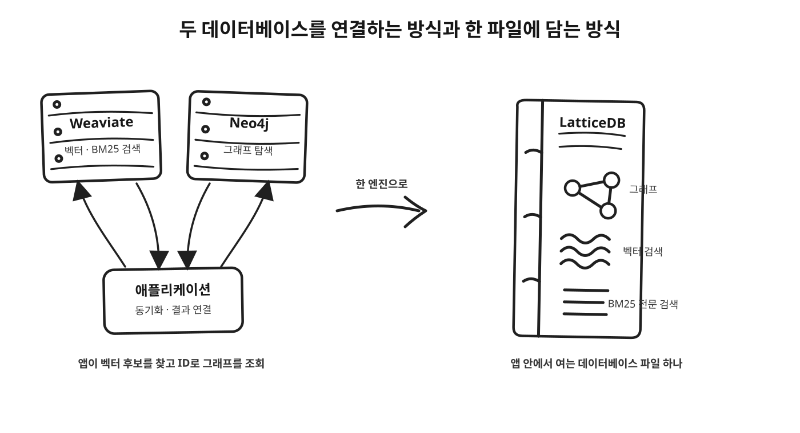

실무에서 Graph RAG를 위해서 Weaviate와 Neo4j를 함께 사용 중인데, 그러다 보면 두 저장소의 데이터를 맞추고 검색 결과를 이어 붙이는 코드는 별도로 관리해야 하고, 이것이 까다롭/번거롭다. 각 데이터베이스의 역할이 분명하다는 건 장점도 되지만, 먼저 벡터 검색으로 문서 청크를 찾고, 그 청크가 속한 문서나 개념을 그래프에서 따라가고, 다시 필요한 메타데이터를 붙이는 식이 데이터를 관리하는 데에 큰 소요가 되기도 한다.

그러던 중 **그래프, 벡터 검색, 전문 검색을 하나로 묶었다**는 LatticeDB를 봤다. 이름만 보면 Weaviate와 Neo4j를 하나로 합쳐 놓은 듯해서 헐레벌떡 알아봤지만, 결론부터 얘기하면 중심은 조금 다르다. LatticeDB는 서버형 벡터 DB와 그래프 DB를 합친 관리형 서비스가 아니라, 애플리케이션 안에서 실행되는 **단일 파일 임베디드 그래프 데이터베이스**다. 그래도 알아두면 좋을 것 같아, 이번 글에서는 두 저장소를 함께 사용했던 관점에서 LatticeDB가 어떤 문제를 줄이는지, 그리고 어떤 요구사항에서는 여전히 기존 구성이 더 나은지 정리해본다. ([공식 문서](https://docs.latticedb.org/), [빠른 시작](https://docs.latticedb.org/getting-started/quickstart))

## LatticeDB는 무엇을 한데 묶나

LatticeDB는 하나의 데이터베이스 파일 안에 속성 그래프와 그 위에서 동작하는 벡터 인덱스, 전문 검색 인덱스를 둔다. 그래프 모델은 노드와 관계(엣지)로 엔터티를 연결하고, 노드와 관계에 속성을 담는다. 그래프 쓰기는 스냅샷 격리를 제공하는 ACID 트랜잭션으로 처리된다. 벡터 검색은 HNSW 인덱스를 이용하고, 전문 검색은 BM25를 지원한다. 이들을 별도의 서비스 세 개로 운영하는 대신, 한 프로세스에서 한 쿼리 계층으로 조회하는 것이 기본 구상이다. 내구성 있는 이벤트 스트림과 그래프 변경 피드도 같은 파일의 트랜잭션/WAL 경로를 공유한다. ([핵심 개념](https://docs.latticedb.org/getting-started/concepts), [저장소와 라이선스](https://github.com/jeffhajewski/latticedb))

프로젝트는 MIT 라이선스이며 엔진은 Zig로 작성됐다. CLI와 C 코어 위에 Python, TypeScript, Go 바인딩을 제공하고, GitHub의 v0.15.0 릴리스에서는 Java JNI 바인딩도 추가됐다. ([릴리스 기록](https://github.com/jeffhajewski/latticedb/releases))

| 관심사 | Weaviate + Neo4j 구성에서 흔한 역할 분리 | LatticeDB가 제공하는 방향 |
|---|---|---|
| 의미 기반 후보 찾기 | Weaviate 벡터 검색 | 노드에 저장한 임베딩의 HNSW 검색 |
| 관계를 따라가기 | Neo4j의 그래프 탐색 | 같은 엔진의 속성 그래프 탐색 |
| 키워드 검색 | Weaviate의 BM25 등 | 내장 BM25 전문 검색 |
| 배포 형태 | 각각의 서버 또는 서비스 | 앱 안에서 여는 하나의 로컬 파일 |



여기서 "한데 묶는다"는 말은 두 제품의 기능을 1:1로 모두 복제한다는 뜻은 아니다. **같은 그래프 데이터와 검색 인덱스를 한 엔진에서 다룬다**는 뜻에 가깝다. LatticeDB의 쿼리 언어는 Cypher의 일부이며, 벡터 인덱스와 운영 기능, 생태계까지 Neo4j나 Weaviate와 동등하다고 가정해서는 안 된다. ([Neo4j 비교](https://docs.latticedb.org/comparisons/vs-neo4j), [임베디드 DB 비교](https://docs.latticedb.org/comparisons/overview))

## 세 검색 방식을 한 쿼리에서

예를 들어 질문과 가까운 청크를 찾고, 그 청크가 속한 문서와 작성자까지 알고 싶다고 하자. 아래는 공식 사이트에 소개된 모양을 단순화한 예다.

```cypher
MATCH (chunk:Chunk)-[:PART_OF]->(doc:Document)-[:AUTHORED_BY]->(author:Person)
WHERE chunk.embedding <=> $query_vector < 0.3
  AND doc.content @@ "neural networks"
RETURN doc.title, chunk.text, author.name
ORDER BY chunk.embedding <=> $query_vector
LIMIT 10
```

`MATCH`는 청크에서 문서, 작성자로 이어지는 관계 경로를 찾는다. `<=>`는 벡터 거리를 나타내고, `@@`는 인덱싱된 텍스트에 대한 BM25 전문 검색 조건이다. 그래서 한 쿼리 안에서 **관계 경로 + 의미 유사도 + 텍스트 조건**을 함께 다룰 수 있다. 연산자와 기본 그래프 문법은 [Cypher 개요](https://docs.latticedb.org/cypher/overview)와 [핵심 개념 문서](https://docs.latticedb.org/getting-started/concepts)에 설명되어 있다.

실제로 쓰려면 데이터베이스를 벡터 저장용으로 열고, 임베딩 차원을 맞춰야 한다. 전문 검색을 쓸 속성에도 인덱스를 만들어야 한다. `<=>`의 `0.3`은 이 쿼리의 거리 조건 예시이지, 모든 임베딩 모델에 통하는 권장 임계값은 아니다. 임베딩 모델·거리 정의·데이터에 맞춰 검증해야 한다. ([빠른 시작](https://docs.latticedb.org/getting-started/quickstart))

다만 예제의 `AND`는 검색 결과를 결합하는 한 가지 방식이다. 전문 검색 점수와 벡터 점수를 정규화해 섞는 하이브리드 랭킹(fusion)을 자동으로 뜻하지는 않는다. 위 쿼리는 벡터 거리를 기준으로 정렬하고, 텍스트 조건은 결과를 거르는 데 쓴다. 따라서 기존 Weaviate 하이브리드 검색의 점수 결합 동작과 동일하다고 생각하면 안 된다. 실제 랭킹은 데이터와 검색 목적에 맞춰 따로 설계하고 비교해야 한다.

## 서버가 아니라 라이브러리

LatticeDB를 선택할 때 가장 큰 차이는 검색 기능보다 **운영 모델**이다. Neo4j나 Weaviate처럼 별도 서버에 접속하는 대신, 애플리케이션 프로세스가 라이브러리로 데이터베이스 파일을 연다. 서버 배포, 네트워크 왕복, 서비스 간 데이터 동기화가 줄어든다. 로컬 개발 도구, 데스크톱 앱, 단일 머신의 RAG 파이프라인, 테스트 환경처럼 데이터 소유자가 한 애플리케이션인 경우에는 매력적일 수 있다.

대신 경계도 분명하다. 공식 비교 문서 기준으로 LatticeDB는 한 프로세스가 파일을 소유하는 임베디드 모델이며, 쓰기는 단일 작성자 방식이다. 여러 서비스가 네트워크를 통해 동시에 같은 데이터베이스에 접근하거나, 여러 머신으로 확장하거나, Neo4j의 전체 Cypher 및 운영 도구가 필요하다면 서버형 구성이 더 적합하다. ([LatticeDB와 Neo4j 비교](https://docs.latticedb.org/comparisons/vs-neo4j))

WAL 기반 장애 복구, 백업, 복제와 지정 시점 복구가 있다는 점은 운영에 도움이 된다. 다만 지정한 시각으로 정확히 되돌아가는 것은 아니다. 복제 주기에 맞춰 저장된 변경분 중 요청 시각 이전의 가장 가까운 상태로 복구한다. 공식 가이드도 이 기능을 백업과 복구로 설명하며, 클러스터링이나 자동 장애 조치와 구분한다. 단일 파일이 간편하다는 사실만으로 고가용성 구성이 되는 것은 아니다. ([백업과 복제 가이드](https://docs.latticedb.org/guides/backup-and-replication))

| 요구사항 | 우선 검토할 선택 |
|---|---|
| 여러 서비스가 같은 그래프에 접속하고 동시에 쓰기 | Neo4j 같은 서버형 그래프 DB |
| 클러스터링, 분산 운영, 성숙한 관리 도구 | Neo4j 또는 기존 서버형 스택 |
| 앱 내부에서 로컬로 그래프·벡터·텍스트를 함께 검색 | LatticeDB |
| 벡터 검색이 핵심이고 그래프 탐색은 거의 없음 | Weaviate 같은 전용 벡터 DB |

이 표는 시작점일 뿐이다. 그래프의 크기, 동시성, 백업과 복구 요구, 언어별 SDK 지원, 운영 경험까지 포함해 실제 워크로드로 평가해야 한다.

## Weaviate와 Neo4j를 바로 대체할 수 있을까

개념상 교집합은 크지만, 기존 두 제품을 바로 없앨 수 있는지는 별개의 질문이다. Weaviate에는 벡터 검색 외에 데이터 모델과 검색 기능이 있고, Neo4j에는 Cypher의 전체 기능, 클러스터링, Browser와 Bloom 같은 도구 및 운영 경험이 있다. LatticeDB는 그 모든 것을 합친 만능 데이터베이스라기보다 **한 애플리케이션이 소유하는 연결된 데이터를 로컬에서 조회하기 위한 작은 엔진**에 초점을 둔다.

따라서 현재 스택이 두 데이터베이스 사이에서 같은 엔터티 ID와 메타데이터를 동기화하고, 단일 애플리케이션이 그 데이터를 소유한다면 시험해볼 이유가 있다. 반대로 여러 서비스의 공용 그래프를 운영하거나, 강한 동시 쓰기와 수평 확장이 필요하다면 단일 파일의 단순함보다 서버형 데이터베이스의 운영 능력이 더 중요할 수 있다.

## 공개 성능 수치는 어떻게 읽을까

LatticeDB 문서의 성능 표도 조심해서 읽어야 한다. 프로젝트 측은 자체 측정치와 다른 제품 문서·외부 자료에서 가져온 수치를 함께 공개하며, 후자는 같은 장비와 방법으로 비교한 결과가 아니라고 밝힌다. 그래서 숫자만 보고 Weaviate나 Neo4j보다 빠르다고 결론 내리기보다는, 우리 데이터와 실제 쿼리로 지연 시간, 정확도, 쓰기 처리량, 운영 부담을 비교하는 편이 낫다. ([벤치마크 수치 읽는 법](https://docs.latticedb.org/comparisons/overview))

공식 벤치마크는 Apple M1에서 단일 스레드로 측정했다고 밝힌다. 공개 수치에는 노드 조회 0.13마이크로초, 백만 개의 128차원 벡터에서 10-NN 검색 평균 0.83밀리초가 포함된다. 벡터 결과는 해당 설정에서 Recall@10 100%, p99 1.8밀리초, 메모리 약 1.04GB로 보고되어 있다. 따라서 “백만 벡터를 0.83ms에 검색한다”는 숫자만 보기보다 인덱스 설정과 메모리 비용도 함께 봐야 한다. ([공식 벤치마크 조건](https://docs.latticedb.org/performance/benchmarks))

그래프 탐색은 SQLite 재귀 CTE와 동일 장비·데이터·벤치마크 하네스에서 비교한 결과가 공개되어 있다. 10만 노드, 50만 엣지의 2-hop 탐색에서 LatticeDB는 38.7마이크로초, SQLite는 548.3마이크로초로 보고됐다. 비교 조건이 공개된 점은 유용하지만, 이 역시 프로젝트가 공개한 자체 벤치마크다. 우리 임베딩 차원과 데이터 분포, 쿼리, 동시성, 메모리 예산으로 재는 것이 맞다. ([경쟁 성능 분석](https://docs.latticedb.org/performance/competitive-analysis))

## 프로젝트 성숙도와 공개 사례

메모에서 참고한 v0.13.0 이후에도 릴리스가 이어졌다. **2026년 10월 11일 확인 기준 GitHub 최신 릴리스는 v0.15.0**이다. 공식 문서에는 Graph RAG, 에이전트 메모리, 로컬 지식 도구가 사용 예로 소개되어 있지만, 사용 시나리오와 장기간 운영된 엔터프라이즈 레퍼런스는 다른 종류의 근거다. 이번에 확인한 공개 자료에서는 Weaviate와 Neo4j를 대규모 서비스에서 대체한 고객 사례를 찾기 어려웠다. 이를 프로덕션 사용 사례가 전혀 없다는 뜻으로 단정할 수는 없지만, 성숙도가 중요한 도입이라면 직접 검증하고 공개 레퍼런스를 추가로 확인해야 한다. ([GitHub 릴리스](https://github.com/jeffhajewski/latticedb/releases))

저장소와 검색 인덱스가 한 파일로 어떻게 동작하는지 설명하는 [LatticeDB 소개 영상](https://www.youtube.com/watch?v=xddLChvxG88)도 참고 자료로 남겨둔다.

## 이번에 정리한 점

처음에는 Weaviate와 Neo4j를 결합한 제품이라는 말에 관심이 갔지만, LatticeDB의 핵심은 기존 두 시스템의 기능을 전부 하나로 복사하는 데 있지 않았다. 관계, 벡터, 텍스트를 같은 파일과 쿼리에서 다루되, 서버 대신 애플리케이션 안에 넣는 선택이다.

내가 쓰는 시스템에서 저장소를 두 개 운영하는 일이 실제 병목인지, 아니면 공유 서버·동시성·확장성이 더 중요한지를 먼저 따져봐야겠다. LatticeDB가 던지는 질문은 “벡터 DB와 그래프 DB를 합칠 수 있나?”보다 **“이 데이터는 정말 별도 서버 둘을 필요로 하나, 아니면 앱 안에서 함께 소유할 수 있나?”**에 가깝다.

### 참고 자료

- [LatticeDB 공식 문서](https://docs.latticedb.org/)
- [Quick Start](https://docs.latticedb.org/getting-started/quickstart)
- [Core Concepts](https://docs.latticedb.org/getting-started/concepts)
- [LatticeDB vs Neo4j](https://docs.latticedb.org/comparisons/vs-neo4j)
- [Choosing an Embedded Graph Database](https://docs.latticedb.org/comparisons/overview)
- [Benchmarks](https://docs.latticedb.org/performance/benchmarks)
- [Backup and Replication](https://docs.latticedb.org/guides/backup-and-replication)
- [LatticeDB 소개 영상](https://www.youtube.com/watch?v=xddLChvxG88)
