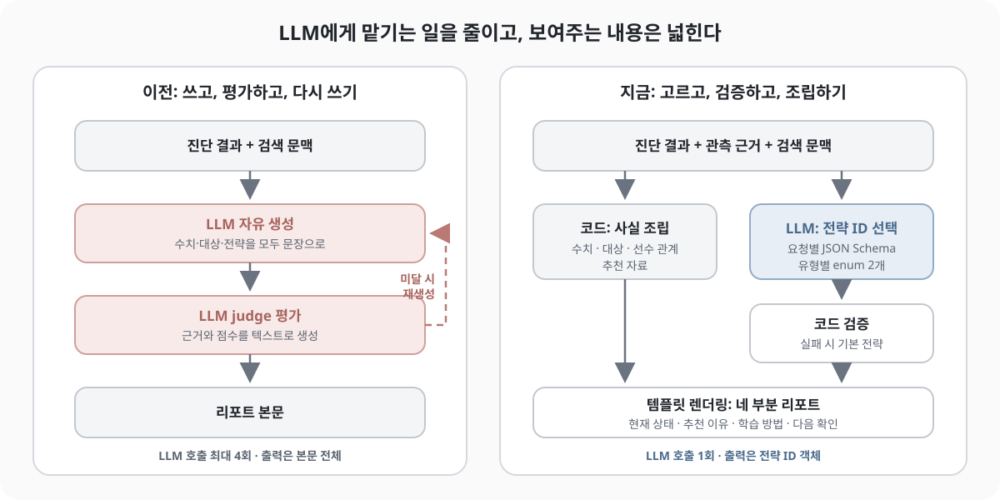

[지난 글](/blog/jev-llm-guardrail/)은 이런 고민으로 끝났다. LLM-as-judge를 붙였더니 응답 시간이 두 배가 됐는데, 이대로 실서비스에 내보내도 괜찮을까. 그 글에서는 판단 모델 Jev를 출력 검사기로 두고, 검사 항목을 규칙·판단 모델·LLM judge·비동기 평가로 나눠 배치하는 방향을 정리했다.

그 뒤 학습 리포트 생성 부분을 다시 손볼 일이 생겼는데, 결과적으로 별도 판단 모델은 넣지 않았다. 모델을 하나 더 띄우는 것 자체가 지연과 운영 상 어려운 일이라 다른 방향을 찾아야했다. 대신 지난번 공부한 Jev 컨셉을 빌려서 LLM이 맡는 일을 줄이는 쪽으로 방향을 잡았다. 이번 글은 그 과정에서 가드레일, 프롬프트, 전략 선택을 어떻게 나눴는지 정리한 기록이다.

##  개선하고자 했던 부분

리포트는 학생의 진단 결과를 바탕으로 현재 상태와 학습 처방을 설명하는 짧은 글이다. 그런데 화면을 다시 보니 문장이 어색했다. "능력이 향상되고 있습니다", "꾸준히 활동하고 있습니다" 같은 말이 표현만 바꿔 여러 번 반복됐다. 틀린 말은 아닌데 읽고 나서 남는 게 없었다.

[자가 교정 RAG 글](/blog/langgraph-langfuse-self-correction-rag/)에서 정리했던 초기 구조는 이랬다.

1. 진단 결과와 검색 문맥을 넣어 LLM이 리포트 본문을 **자유롭게 생성**한다.
2. LLM judge가 본문을 평가한다.
3. 점수가 낮으면 피드백을 붙여 재생성하고, 다시 평가한다.

먼저 지난 글에서 다룬 지연 문제가 있다. 생성과 평가가 모두 텍스트를 만드는 호출이라, 재생성까지 한 번 돌면 LLM 호출이 네 번이 된다. 품질도 문제였다. 본문 전체를 자유롭게 생성하는 이상 반복이나 근거 없는 일반화는 매번 새로 생길 수 있고, 이걸 judge로 잡으려면 평가 기준을 계속 늘려야 한다. 그러면 judge 프롬프트와 호출 비용도 같이 무거워진다.

## 사실은 코드가, 선택은 LLM이

그래서 리포트 문장 중에 LLM이 꼭 써야 하는 부분이 어디인지부터 다시 봤다. 문장을 하나씩 뜯어보니 대부분은 이미 데이터에 있는 사실이었다.

- 어떤 범위에서 몇 문항을 풀었고, 그중 몇 개를 틀렸는지
- 어떤 단위가 처방 대상인지, 그 처방이 어떤 유형인지
- 그 단위의 선수 단위가 무엇인지
- 추천할 문항과 콘텐츠가 있는지

이런 내용은 LLM이 다시 쓸 이유가 없다. 다시 쓰다가 숫자가 바뀌거나, "이 학년 전체를 숙달했다", "꾸준히 하면 반드시 향상된다"처럼 근거 없이 일반화된 문장이 나올 수 있다.

판단이 필요한 부분은 사실상 하나였다. 이 학생에게 이 처방을 어떤 방식으로 문장으로 풀어서 제시할지다. 같은 유형의 처방이라도 어떻게 짚어줄지는 학생의 관측 근거를 보고 골라야 한다.

그래서 역할을 이렇게 나눴다.


| 부분                         | 담당              | 이유                     |
| -------------------------- | --------------- | ---------------------- |
| 진단 수치, 처방 대상, 선수 관계, 추천 자료 | 코드가 데이터에서 조립    | 이미 있는 사실이라 다시 쓸 필요가 없다 |
| 처방별 지도 전략                  | LLM이 허용 목록에서 선택 | 근거를 보고 고르는 판단이 필요하다    |
| 선택 결과 검증, 실패 시 대체          | 코드              | 통과/실패가 명확한 형식 문제다      |
| 최종 본문                      | 코드가 템플릿으로 렌더링   | 선택된 전략과 사실을 문장으로 잇는다   |


처방 유형은 네 가지(편의상 유형 1~4)이고, 유형마다 미리 정해둔 지도 전략이 두 개씩 있다. LLM의 출력은 본문이 아니라 "처방 유형 → 전략 ID"를 담은 짧은 객체 하나가 됐다.

```json
{ "유형 1": "<전략 ID>", "유형 2": "<전략 ID>" }
```



## 가드레일은 생성 계약으로

이 구조에서 가드레일은 출력 뒤에 붙는 별도 검사기라기보다, 무엇을 출력해도 되는지 미리 정해둔 계약과 그 계약을 확인하는 코드에 가깝다. 계약은 요청마다 JSON Schema로 만들어 넘기고, 내용은 단순하다.

- 이번 학생에게 실제로 나온 처방 유형만 키로 허용한다.
- 각 키의 값은 그 유형의 전략 두 개 중 하나로 제한한다(enum).
- 필요한 키는 모두 있어야 하고, 그 밖의 키는 받지 않는다.

이렇게 하면 모델이 낼 수 있는 출력의 모양이 처음부터 좁아진다. 설명을 덧붙이거나, 요청에 없는 처방 유형이나 목록에 없는 전략을 만들어낼 여지가 줄고, 출력도 수십 토큰 수준으로 짧아진다.

형식을 강하게 제한하면 추론 품질이 떨어질 수 있다는 연구도 있다. 다만 여기서는 긴 추론을 출력할 필요 없이 목록에서 하나를 고르기만 해서 영향이 크지 않을 거라고 봤다. 선택 근거까지 함께 출력하게 된다면 그때 다시 따져봐야 할 것 같다.

Schema를 넘기더라도 코드 검증은 남겨뒀다. 서빙 환경에 따라 Schema 강제가 완벽하지 않을 수 있고, 출력이 중간에 잘리는 건 Schema로 막을 수 없다. 코드에서는 대략 이런 것들을 다시 확인한다.


| 확인 항목 | 걸리는 경우                     |
| ----- | -------------------------- |
| 종료 사유 | 길이 제한으로 출력이 잘림             |
| 파싱    | JSON이 아니거나 같은 키가 두 번 나옴    |
| 키     | 필요한 처방 유형이 빠졌거나 없는 유형이 추가됨 |
| 값     | 해당 유형의 허용 전략이 아닌 값         |


검증에 실패하면 재생성하지 않고 유형별 기본 전략으로 바로 대체한다. 지난 글에서는 RETRY 경로에 상한과 피드백을 두는 이야기를 했는데, 여기서는 그 경로를 아예 없앴다. 두 개 중 하나를 고르는 문제라 기본값을 미리 정해둘 수 있고, 기본값으로 가더라도 사실 부분은 코드가 조립하니 리포트가 틀리지는 않는다. LLM을 다시 부를 만큼의 차이는 아니라고 판단했다.

## 프롬프트는 하나로 두고, 근거는 자세히

전략마다 다른 시스템 프롬프트를 쓰는 구조는 아니다. 시스템 프롬프트는 "주어진 목록에서 지도 전략 ID만 골라 JSON으로 답하라"는 취지의 짧은 문장 하나다.

대신 입력에 더 신경을 썼다. 사용자 프롬프트에는 실제 처방 유형의 허용 전략, 처방 대상, 평가 범위, 관측 근거, 선택 지침, 교육과정 참고 자료가 들어간다. 그중 관측 근거를 정리할 때 챙긴 것들은 이렇다.

- 처방 대상과 진단 단위를 ID로 정확히 연결한다. 이름이 비슷한 단위를 섞지 않는다.
- 관측된 오답이 있는 대상, 모두 정답인 대상, 근거가 없는 대상의 수를 구분해서 넘긴다.
- AI가 추정한 매핑만 있는 대상은 따로 표시한다. 확정된 근거와 같은 무게로 읽히지 않게 하려는 것이다.
- 추천 문항과 콘텐츠가 실제로 있는지, 고유 문항이 몇 개인지 넘긴다.
- 단위끼리 겹칠 수 있는 풀이 횟수를 합산하지 않는다. 중복 진단 행이나 이상한 정오답 값을 임의로 해석하지 않는다.

선택이 어긋난다면 모델의 판단력보다 넘겨준 근거가 흐릿한 탓일 수도 있다. "오답 3개"라고만 주면 같은 문항을 세 번 틀린 건지, 서로 다른 세 문항을 틀린 건지 모델은 알 수 없다. 출력을 좁힌 만큼 입력 근거도 정확해야 선택이 의미가 있다.

## 짧게 고르고, 길게 보여주기

출력을 전략 ID로 줄이고 나니 이번에는 리포트가 빈약해 보였다. 사실 문장만 조립하던 초기 템플릿이 짧았기 때문이다. 반복 문제는 사라졌는데 읽을 거리가 없어진 것이다.

그래서 본문을 네 부분으로 넓혔다.

1. **현재 학습 상태.** 선택한 범위, 관측된 정오답, 진단 단위 수를 구분해서 보여준다.
2. **추천 이유.** 실제 처방 대상과 처방 유형을 설명한다.
3. **구체적인 학습 방법.** 선택된 전략 문장에 실제 추천 자료 예시를 연결한다.
4. **다음 확인 사항.** 풀이를 설명해보기, 막힌 단계 찾기, 기초를 확인한 뒤 원래 단위 다시 풀기 같은 다음 행동을 안내한다.

늘어난 문장은 모두 템플릿과 조건부 문장으로 만들었다. 추천 자료가 있으면 예시를 붙이고, 없으면 그 문장을 빼는 식이다. LLM 호출이나 생성 길이는 그대로라서, 확장 전후의 같은 사례를 비교하면 모델 입력·출력 토큰은 똑같고 본문 길이만 몇 배로 늘었다.

생성을 줄였다고 내용까지 줄일 필요는 없었다. 모델이 고르는 건 짧은 결정 하나지만, 거기에 이어 붙일 수 있는 문장은 생각보다 많았다. 사실 부분을 코드가 갖고 있으니 "이 근거가 있을 때만 이 문장을 쓴다" 같은 조건을 걸기도 쉬웠고, 덕분에 근거 없는 일반화도 막기 쉬웠다.

## 비용과 지연은 얼마나 달라졌나

같은 학생과 같은 단위에 대해 바뀌기 전후의 trace를 하나씩 비교해봤다.


| 구분        | 이전 (생성·평가·재생성·재평가) | 이후 (전략 선택) |
| --------- | ------------------ | ---------- |
| LLM 호출    | 4회                 | 1회         |
| 총 토큰      | 기준                 | 약 85% 감소   |
| LLM 처리 시간 | 수십 초               | 1초대        |
| 출력        | 본문 전체와 평가문         | 전략 ID 객체   |


다만 두 trace는 입력 이력의 양이 달랐고 하드웨어 부하도 통제하지 않았다. 같은 입력으로 반복 실험한 게 아니라 대응하는 사례 한 쌍을 비교한 것이라, 일반적인 성능 수치로 보기는 어렵다.

그래도 절감의 대부분이 어디서 왔는지는 분명하다. 네 부분 확장과는 상관없이, 자유 생성·평가·재생성 호출을 선택 하나로 바꾼 데서 왔다. 텍스트를 길게 생성하던 호출 네 번이 수십 토큰짜리 호출 한 번이 됐다.

## 단순 조건은 코드로, 모델에는 문맥 판단만

여기까지 하고 프롬프트를 다시 보다가 걸리는 부분이 있었다. 프롬프트에 넣어둔 선택 지침인데, 대략 이런 내용이었다.

- 선수 문항이 있으면 전략 A를, 없으면 전략 B를 우선한다.
- 관측된 오답이 있으면 전략 A를, 없으면 전략 B를 우선한다.
- 추천할 문항이 몇 개 이상이면 전략 A를 우선한다.

다시 보니 판단이라기보다 조건문에 가까웠다. 선수 문항이 있는지, 오답이 있는지, 문항이 몇 개인지는 코드가 이미 알고 있는 값이다. 그걸 굳이 문장으로 바꿔 프롬프트에 넣고 모델이 따라주기를 기대하고 있었던 셈이다. 코드로 쓰면 조건문 한 줄이고 틀릴 일도 없다.

[Jev 판단 계층 글](/blog/jev-decision-ai/)과 [가드레일 글](/blog/jev-llm-guardrail/)에서 정리했던 세 층 구조를 여기에 대어봐도 마찬가지다.

1. 규칙으로 정할 수 있는 것은 규칙으로 정한다.
2. 문맥을 읽어야 하는 판단만 모델에게 맡긴다.
3. 모델의 결정을 실제 행동으로 바꾸는 일은 다시 코드가 한다.

이번 구조는 3번은 지키고 있었지만 1번과 2번의 경계가 흐릿했다. 모델의 일을 줄여놓고도, 남은 일 중 상당 부분이 사실은 코드가 할 일이었다. 모델에게 남겨야 할 건 이런 쪽이다. 최근에는 잘 맞히는데 예전 기록이 낮게 남아 있는 경우, 오답이 한 단계에 몰려 있는지 여러 단계에 흩어져 있는지, 같은 유형 안에 성격이 다른 단위가 섞여 있는 경우처럼 조건 몇 개로 정리되지 않고 근거를 같이 읽어야 하는 판단이다.

이번 작업에서 근거 데이터(입력)를 JSON 구조로 정리해 프롬프트에 넣긴 했지만, 그것만으로 Jev 같은 판단 계층을 구현했다고 말하기는 어렵다. Jev 글에서 가져오고 싶었던 건 형식보다는 관점이었다. 무엇을 판단하는지, 어떤 근거로 판단하는지, 그 판단을 어떻게 검증하는지를 나눠서 설계하는 것이다. 그 기준으로 보면 이번 구조는 검증 쪽은 단단해졌지만 판단 쪽은 아직 반쯤 온 상태다.

## 남은 TO DO..

- **검증 통과는 적합성이 아니다.** 지금의 가드레일은 "허용된 전략 중 하나를 골랐는가"만 보장한다. 그 학생에게 맞는 전략이었는지는 교사 검토 기준과 전략 간 비교 평가가 있어야 말할 수 있다. 두 개 중 하나를 유형 단위로 고르는 구조라, 단위마다 다른 전략이 필요한 경우도 아직 표현하지 못한다.
- **줄어든 생성, 비어 있는 판단.** 빽빽한 가드레일과 조건부 렌더링으로 구조화하고 나니 생성의 역할이 너무 줄어든 건 아닌가 싶다. 선택 지침의 단순 조건을 코드로 옮기고, 그렇게 비운 자리에 모델이 맡을 "판단" 영역을 따로 설계하고 평가해야 한다.
- **입력이 바뀌면 다시 재기.** 근거와 검색 문맥이 늘면 토큰, 지연, 동시성은 다시 측정해야 한다.

## 정리

- 리포트 문장 대부분은 이미 데이터에 있는 사실이었다. 사실은 코드가 조립하고, LLM은 처방별 전략 ID만 고르게 했다.
- 가드레일은 별도 검사 모델이 아니라 생성 계약(요청별 JSON Schema)과 코드 검증으로 구현했다. 실패하면 재생성 없이 기본 전략으로 대체한다.
- 출력은 짧게 줄이고 본문은 템플릿으로 네 부분까지 넓혔다. 모델 토큰은 그대로였다.
- 생성·평가·재생성 호출을 선택 하나로 바꾸면서 비용과 지연이 크게 줄었다. 다만 통제된 실험은 아니다.

지난 글의 고민은 "LLM-as-judge의 지연을 어떻게 줄일까"였는데, 실제로 한 일은 judge를 빠르게 만드는 것이 아니라 **judge가 검사할 생성 자체를 줄이는 것**이었다. 모델에게 덜 맡길수록 검사는 가벼워졌고 내용은 오히려 늘릴 수 있었다. 다만 생성의 몫이 작아진 만큼, 이제는 모델에게 남길 판단을 설계할 차례인 것 같다. 사실과 형식은 코드가 지키고, 모델은 근거를 읽고 판단하는 데 집중하는 구조로.

## 참고

- Jev: LLM 앞에 놓이는 빠른 판단 계층 (이전 글): /blog/jev-decision-ai/
- Jev를 LLM 뒤에 두기: 답변을 내보내기 전의 가드레일 (이전 글): /blog/jev-llm-guardrail/
- LangGraph와 Langfuse를 활용한 자가 교정(Self-Correction) RAG 파이프라인 설계기 (이전 글): /blog/langgraph-langfuse-self-correction-rag/
- JSON Schema — Understanding JSON Schema: [https://json-schema.org/understanding-json-schema/](https://json-schema.org/understanding-json-schema/)
- OpenAI — Structured Outputs: [https://platform.openai.com/docs/guides/structured-outputs](https://platform.openai.com/docs/guides/structured-outputs)
- Tam et al., Let Me Speak Freely? A Study on the Impact of Format Restrictions on Performance of Large Language Models (2024): [https://arxiv.org/abs/2408.02442](https://arxiv.org/abs/2408.02442)