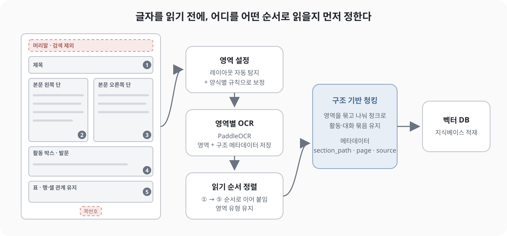

[메타 태깅 파이프라인 글](/blog/ai-agent-content-metadata-tagging-pipeline/)에서 "OCR은 텍스트 추출이 아니라 불확실성 관리다"라고 적은 적이 있다. confidence를 함께 남기고, 낮은 영역은 검수로 보내자는 정도의 이야기였다. 그런데 실제로 그 불확실성이 문제가 되어 OCR 전처리를 다시 손보게 됐다. 이번 글은 그 재작업을 정리한 기록이다.

발단은 스캔본 교재(지도서·워크북)에서 추출한 텍스트의 글자가 깨진다는 보고였다. 재작업 요청과 함께 원인 분석 자료를 전달받았는데, 요지는 이랬다.

- 인코딩 문제는 아니다. 저장된 파일은 정상 UTF-8이고 문자 깨짐(mojibake)은 없다.
- 해상도 문제도 아니다. 렌더링 해상도를 올리거나 원본 이미지를 그대로 넣어도 같은 자리에서 같은 글자가 틀린다.
- 남는 원인은 OCR 엔진의 한글 인식, 특히 **받침 혼동**이다. 그러니 엔진을 바꿔보자.

원인 분석 자체는 납득이 갔다. 다만 작업하면서 조금 다르게 접근하게 됐다. 이 텍스트의 최종 목적지가 **지식베이스용 벡터 데이터베이스**였기 때문이다. 글자를 정확히 읽는 것만으로는 충분하지 않고, 읽은 텍스트가 **청킹하기 좋은 모양**이어야 했다. 그래서 엔진 비교와 함께 페이지의 영역을 나누고 읽는 순서를 정하는 작업까지 같이 진행했다.

## 받침 하나가 검색을 어떻게 망가뜨리나

전달받은 자료에 정리된 오인식은 대략 이런 모양이었다.

| 원문 | OCR 결과 | 혼동 |
|---|---|---|
| 마음을 표현해야 하는 이유 | 마음**올** 표현해야 하는 이유 | ㄹ ↔ ㅇ 계열 |
| 정서를 알아보고 | 정서**름** 알아보고 | ㄹ ↔ ㅁ |
| 이야기 나누어 봅시다 | 이야기 나누어 **붙**시다 | ㅂ ↔ ㅌ |
| 우리 반에 곰이 있어요 | 우리 반에 **곧**이 있어요 | ㅁ ↔ ㄷ |

틀리는 자리가 주로 조사와 어미다. 사람이 읽으면 대충 뜻은 통하지만, 기계 입장에서는 꽤 치명적이다.

- **키워드 검색이 빗나간다.** BM25 같은 어휘 기반 검색은 토큰이 정확히 일치해야 점수가 붙는다. "감정을 조절"이 "감정올 조절"로 저장되면 형태소 분석부터 어긋난다. [하이브리드 검색 글](/blog/hybrid-retrieval-bm25-vector-eval/)에서 BM25가 정확한 용어 매칭에 강하다고 정리했는데, 그 강점이 OCR 오류 앞에서는 그대로 약점이 된다.
- **임베딩도 조금씩 흔들린다.** 벡터 검색은 오타에 비교적 관대하지만, 한 문장에 오류가 여러 개 섞이면 의미 표현이 흐려진다.
- **검색되더라도 답변 근거로 쓰기 어렵다.** 깨진 문장이 LLM 컨텍스트로 들어가면 모델이 그럴듯하게 보정할 수도 있지만, 그 보정이 맞는다는 보장은 없다. 사용자에게 근거 문장으로 그대로 노출될 때의 신뢰 문제도 있다.

## 글자만 맞으면 될까

엔진을 바꾸면 받침 문제는 줄어들 수 있다. 그런데 교재 스캔본을 다시 보니 글자 정확도와는 별개의 문제가 눈에 들어왔다. 교재는 일반 문서보다 레이아웃이 훨씬 복잡하다.

- 본문이 두 단으로 나뉜 페이지
- 활동 안내나 발문이 담긴 박스, 말풍선
- 표와 학습지 형태의 빈칸
- 삽화 안에 들어간 글자
- 모든 페이지에 반복되는 머리말, 차시 표시, 쪽번호

페이지 전체를 한 번에 OCR하면 엔진은 대체로 위에서 아래, 왼쪽에서 오른쪽으로 줄을 이어 붙인다. 두 단 레이아웃에서는 왼쪽 단의 한 줄과 오른쪽 단의 한 줄이 섞이고, 활동 박스 문장이 본문 중간에 끼어들고, 쪽번호와 머리말이 페이지마다 반복해서 들어간다.

```text
1. 마음 알아보기          활동 1 친구의 표정을 보고
오늘은 여러 가지 감정에    어떤 마음인지 적어 봅시다.
대해 알아볼 거예요.        12
```

이 텍스트를 그대로 고정 길이로 자르면, 한 청크 안에 서로 다른 맥락의 문장이 섞인다. 글자가 하나도 틀리지 않았더라도 **검색 단위로서는 품질이 낮은 청크**가 된다. 그래서 이번 작업에서 OCR 품질을 "글자를 얼마나 정확히 읽었나"와 "청킹할 수 있는 순서와 단위로 읽었나" 두 가지로 나눠서 봤다.

## 세 엔진 비교

비교한 엔진은 PaddleOCR, EasyOCR, Tesseract 5 세 가지다. 셋 다 사내에 설치해서 쓸 수 있는 오픈소스라 원문 이미지를 외부로 보내지 않아도 된다는 공통점이 있다. 외부 OCR API나 멀티모달 LLM도 선택지로 언급됐지만, 데이터 반출 협의가 필요해서 이번 비교에서는 사내 설치형을 먼저 봤다.

| | EasyOCR | Tesseract 5 | PaddleOCR |
|---|---|---|---|
| 구조 | CRAFT 텍스트 검출 + CRNN 인식 | LSTM 기반 줄 단위 인식 | PP-OCR 검출·인식 파이프라인 |
| 한국어 | `ko` 언어 지원 | `kor` 학습 데이터 | 한국어 인식 모델 제공 |
| 레이아웃 | 텍스트 박스 검출까지 | 페이지 분할 모드(PSM)로 조절 | 레이아웃 분석 모듈(PP-Structure 계열) 별도 제공 |
| 설치·운영 | 간단 | 가장 가벼움 | 의존성이 큰 편 |

각 엔진을 볼 때 기준으로 삼은 것은 이랬다.

- **받침 오인식이 줄어드는가.** 원래 문제의 핵심이다. 수기로 옮겨 적은 정답 페이지와 대조해 보는 방식이 가장 확실하다.
- **영역 단위로 넣었을 때 안정적인가.** 페이지 전체가 아니라 잘라낸 영역 이미지를 넣었을 때도 잘 읽는지.
- **레이아웃 정보를 함께 다룰 수 있는가.** 영역 좌표와 유형을 같은 흐름에서 다룰 수 있으면 뒤의 청킹 설계가 단순해진다.
- **처리 시간.** 재처리 대상이 적지 않아서, 정확도가 조금 오르는 대신 처리 시간이 크게 늘어나면 곤란했다.

Tesseract 5는 깨끗한 인쇄물에서 안정적이고 가장 가볍다는 장점이 있지만, 다단이나 박스가 섞인 페이지에서는 PSM과 전처리를 상황에 맞게 조정해야 하는 편이다. 공식 문서에서도 300dpi 이상의 해상도, 기울기 보정, 이진화 같은 전처리가 품질에 영향을 준다고 안내한다. EasyOCR은 이미 파이프라인에 들어가 있었지만, 이번 문제의 출발점이 된 받침 혼동이 그대로 남았다.

최종적으로는 **PaddleOCR**을 택했다. 한국어 인식 모델을 따로 제공한다는 점과 함께, 레이아웃 분석 기능을 같은 생태계 안에서 쓸 수 있다는 점이 결정에 영향을 줬다. PaddleOCR 쪽에서도 문서를 좌표 정보가 포함된 JSON이나 Markdown으로 바꿔 RAG 파이프라인에 넣는 쓰임새를 강조하고 있어서, 이번 작업의 목적과 방향이 잘 맞았다. 대신 설치 의존성이 큰 편이라, 운영 환경에 올릴 때는 다른 엔진보다 준비할 것이 많다는 점도 감안해야 한다.

## 영역 설정: 자동 탐지와 양식별 보정

영역 설정은 두 가지를 같이 썼다.

**레이아웃 자동 탐지.** 레이아웃 분석 모델로 페이지에서 제목, 본문, 표, 그림 같은 영역을 먼저 찾는다. 어떤 교재가 들어와도 일단 기본적인 영역 구분은 할 수 있다.

**양식별 규칙으로 보정.** 교재는 같은 시리즈 안에서 양식이 반복된다. 지도서와 워크북은 각자 정해진 틀이 있고, 머리말과 쪽번호의 위치, 활동 박스의 모양도 거의 같다. 자동 탐지가 놓치거나 잘못 나누는 부분은 이 양식을 기준으로 보정했다. 머리말·쪽번호처럼 본문이 아닌 영역을 구분해두고, 활동 박스처럼 자동 탐지가 본문과 잘 구분하지 못하는 영역은 양식 기준으로 따로 묶는 식이다.

자동 탐지만 쓰면 양식 특유의 요소를 놓치고, 수동 지정만 쓰면 양식이 조금만 달라져도 영역이 어긋난다. 둘을 함께 쓰는 쪽이 교재처럼 **양식이 반복되지만 완전히 같지는 않은** 자료에 맞았다.



영역을 나눈 뒤에는 각 영역을 따로 OCR하고, **읽기 순서**를 정해 이어 붙였다. 두 단 본문이라면 왼쪽 단을 끝까지 읽고 오른쪽 단으로 넘어가고, 활동 박스와 표는 본문 흐름에서 떼어 따로 둔다. 같은 페이지라도 이렇게 읽으면 앞의 섞인 텍스트가 이렇게 바뀐다.

```text
[제목] 1. 마음 알아보기
[본문] 오늘은 여러 가지 감정에 대해 알아볼 거예요.
[활동] 활동 1 친구의 표정을 보고 어떤 마음인지 적어 봅시다.
```

영역 단위로 나눠 넣는 것은 OCR 엔진 입장에서도 입력이 단순해진다는 의미가 있다. 다단이나 박스 경계에서 줄을 잘못 잇는 문제를 엔진에 맡기지 않고 앞단에서 정리하는 셈이다.

## 청킹까지 이어서 보기

### 영역 표시는 있었지만, 청킹이 쓰지 못하고 있었다

영역을 나누면서 기존 파이프라인이 무엇을 남기고 있었는지도 다시 봤다. 정보가 아예 없지는 않았다.

- 추출 텍스트 안에는 `[페이지 N]`, `[이미지 N]`, `(삽화 이미지)` 같은 구분 표시가 들어가 있었다.
- 별도 JSON에는 추출 단위 ID, 텍스트 레이어 직접 추출인지 OCR인지, 좌표, 원본 이미지, 검수 상태가 남아 있었다.

문제는 청킹 단계가 이 정보를 읽지 않았다는 점이다. 기존 분할은 주로 **빈 줄을 기준으로** 텍스트를 나눴고, 영역 정보는 따로 저장만 되어 있었다. 구조 정보가 있어도 청킹이 쓰지 않으면, 결국 읽기 순서가 꼬인 텍스트를 빈 줄로 자르는 것과 크게 다르지 않다.

그래서 이번 영역 분리에서는 **영역별 텍스트와 구조화된 메타데이터를 함께 저장**하고, 청킹이 그 구조를 직접 읽도록 하는 쪽으로 방향을 잡았다.

### 영역에 남겨둘 정보

청킹에 필요한 정보를 기준으로 영역마다 남길 필드를 정리하면 이렇다.

| 필드 | 청킹에서의 쓰임 |
|---|---|
| `region_id`, `parent_id` | 삽화 안의 대사, 삽입된 교재처럼 영역 사이의 소속 관계 유지 |
| `type` | 제목·본문·표·대화·캡션·꼬리말 구분 |
| `section_path` | 각 청크에 "단원 → 활동 → 소제목" 같은 문맥을 연결 |
| `reading_order` | 다단 문서에서 올바른 읽기 순서 유지 |
| `group_id` | 질문과 예시, 그림과 캡션처럼 함께 있어야 하는 영역 묶기 |
| `split_policy` | 반드시 함께 유지할 묶음인지, 내부를 나눠도 되는지 지정 |
| `index_policy` | 본문 검색 대상인지, 쪽번호·장식처럼 검색에서 제외할 대상인지 구분 |
| `source`, `page`, `bbox`, `review_status` | 원본 위치 추적과 미검수 결과 식별 |

처음 생각했던 메타데이터는 `type`과 `page` 정도였는데, 교재 구조를 놓고 보니 **영역 사이의 관계**를 표현하는 필드가 더 중요했다. `parent_id`와 `group_id`가 없으면 질문과 예시 답변, 삽화와 그 안의 대사가 각자 떨어진 조각이 된다.

`index_policy`도 눈여겨볼 만하다. 머리말·쪽번호는 본문이 아니니 버려도 될 것 같지만, 쪽번호처럼 출처 표시에 쓸 정보는 버리기보다 **보존하되 본문 검색에서만 제외**하는 편이 낫다. 읽지 않을 것과 검색하지 않을 것은 다른 문제다.

### 활동 하나를 예로 들면

교재의 활동 하나는 이런 구조를 가진다.

```text
활동: 친구의 마음 알아주기
├─ 제목                 → 하위 청크의 문맥으로 전달
├─ 활동 지시문  ┐
├─ 질문         ├─→ 같은 활동 묶음으로 연결
├─ 예시 답변    ┘
├─ 삽화
│   ├─ 화자 A 대사  ┐
│   └─ 화자 B 대사  ┘→ 대화 묶음 유지
├─ 표                   → 행·셀 관계 유지하며 분할
└─ 인쇄 쪽번호          → 출처로 보존, 본문 검색에서는 제외
```

제목은 그 자체로 청크가 되기보다 아래 청크들의 `section_path`로 내려가 문맥을 보탠다. 지시문, 질문, 예시 답변은 `group_id`로 묶여 같은 청크에 들어간다. "어떤 질문에 어떤 답을 기대하는가"가 한 청크 안에 있어야 검색되었을 때 의미가 통하기 때문이다. 표는 길면 나눌 수 있지만 행과 셀의 관계가 깨지지 않는 단위로만 나눈다.

### 영역이 곧 청크는 아니다

이 작업에서 가장 중요하게 정리된 생각은 **영역 하나가 반드시 청크 하나가 되는 것은 아니라는 점**이었다. 영역은 원문의 구조이고, 청크는 그 구조를 바탕으로 길이와 용도에 맞게 묶은 결과다. 짧은 영역 여러 개가 하나의 청크로 묶이기도 하고, 긴 표 하나가 여러 청크로 나뉘기도 한다. `split_policy`는 그 묶고 나누는 범위를 정하는 장치다.

앞에서 보여준 `[제목]`, `[본문]` 같은 텍스트 구분자도 같은 맥락에서 봐야 한다. 이런 표시는 사람이 추출 결과를 훑어볼 때는 편하지만, 청킹이 이 문자열을 파싱하게 만들면 다시 텍스트에 의존하는 구조가 된다. 구분자는 **사람이 읽는 보조 표시**로 두고, 실제 청킹은 JSON의 구조 정보를 사용하도록 연결하는 쪽이 맞다.

이렇게 구조를 남겨두면 청크에도 자연스럽게 메타데이터가 따라온다.

```json
{
  "text": "친구의 표정을 보고 어떤 마음인지 적어 봅시다. ...",
  "section_path": ["3단원", "친구의 마음 알아주기", "활동 1"],
  "region_ids": ["r-12-04", "r-12-05", "r-12-06"],
  "page": 12,
  "source": "ocr",
  "review_status": "unreviewed"
}
```

`section_path`는 검색 결과를 필터링하거나 답변에서 출처를 보여줄 때 쓸 수 있고, `region_ids`와 `page`는 원문 위치를 되짚을 때 필요하다. `source`는 메타 태깅 글에서도 강조했던 부분인데, 텍스트 레이어에서 바로 뽑은 원문과 OCR로 읽은 원문은 신뢰도가 다르니 구분해서 남겨두는 편이 좋다. `review_status`가 있으면 검수가 끝나지 않은 OCR 결과를 따로 다룰 수 있고, 나중에 엔진을 바꾸거나 재처리할 때도 어떤 청크를 다시 만들어야 하는지 바로 찾을 수 있다.

## 그래도 남는 것들

엔진을 바꾸고 영역을 나눠도 OCR이 완벽해지지는 않는다. 따로 챙겨야 할 것들도 남는다.

- **사후 교정 규칙은 조심스럽게.** "올→을", "름→를"처럼 자주 나오는 패턴을 규칙으로 고치는 방법도 거론됐다. 가독성은 바로 좋아지지만, 원문과 다른 텍스트를 만들 위험이 있다. 실제로 "올"로 끝나는 어절도 있기 때문이다. 적용하더라도 원본 OCR 결과는 따로 보존하는 쪽이 안전하다.
- **양식에서 벗어나는 페이지.** 표지, 부록, 삽화 위주 페이지처럼 양식 규칙이 맞지 않는 페이지가 꼭 있다. 이런 페이지는 자동 탐지 결과만 쓰거나 검수 대상으로 따로 분류하는 식의 예외 처리가 필요하다.
- **평가 방법.** 글자 정확도는 몇 페이지를 수기로 옮겨 적은 정답과 비교하면 잴 수 있다. 하지만 이번 작업의 진짜 목적은 검색 품질이라, 최종적으로는 같은 질의로 재처리 전후의 검색 결과를 비교해보는 것까지 가야 효과를 말할 수 있다.

## 정리

처음 받은 과제는 "OCR 엔진을 바꿔서 글자 깨짐을 줄이자"였다. 작업을 마치고 보니 실제로 한 일은 **"벡터 DB에 넣기 좋은 원문을 만들자"**에 더 가까웠다.

- 글자 깨짐의 원인은 엔진의 한글 받침 인식이었고, 해상도나 인코딩 문제는 아니었다.
- PaddleOCR, EasyOCR, Tesseract 5를 비교해 PaddleOCR을 택했다. 한국어 인식 모델과 레이아웃 분석을 같은 흐름에서 쓸 수 있다는 점이 컸다.
- 교재는 레이아웃이 복잡해서, 글자 정확도와 별개로 읽기 순서가 청크 품질을 좌우했다.
- 영역 설정은 레이아웃 자동 탐지와 양식별 규칙 보정을 함께 썼다.
- 기존에도 영역 정보는 일부 남아 있었지만 청킹은 빈 줄 기준으로 나누고 있었다. 영역별 텍스트와 구조화된 메타데이터를 함께 저장해 청킹이 구조를 직접 읽도록 했다.
- 영역 사이의 관계(`parent_id`, `group_id`)와 묶음·검색 정책(`split_policy`, `index_policy`)이 유형 정보만큼 중요했다.
- 영역은 원문의 구조이고, 청크는 그 구조를 길이와 용도에 맞게 묶은 결과다. 텍스트 구분자는 사람이 읽는 보조 표시로 둔다.

OCR을 파이프라인의 맨 앞 단계로만 보면 "글자를 잘 읽었는가"까지만 확인하게 된다. 그런데 그 텍스트가 어디로 가는지를 먼저 정해두니, 무엇을 읽고 무엇을 버릴지, 어떤 순서로 이어 붙일지가 자연스럽게 정해졌다. 전처리의 기준은 결국 그 데이터가 쓰일 자리에서 정해지는 것 같다.

## 참고 자료

- [AI로 여러 콘텐츠 형식에 메타 태깅하기 (이전 글)](/blog/ai-agent-content-metadata-tagging-pipeline/)
- [Hybrid Retrieval 개념과 BM25와 Vector 검색 비교 실험 (이전 글)](/blog/hybrid-retrieval-bm25-vector-eval/)
- [PaddleOCR — GitHub](https://github.com/PaddlePaddle/PaddleOCR)
- [EasyOCR — GitHub](https://github.com/JaidedAI/EasyOCR)
- [Tesseract — Improving the quality of the output](https://tesseract-ocr.github.io/tessdoc/ImproveQuality.html)
